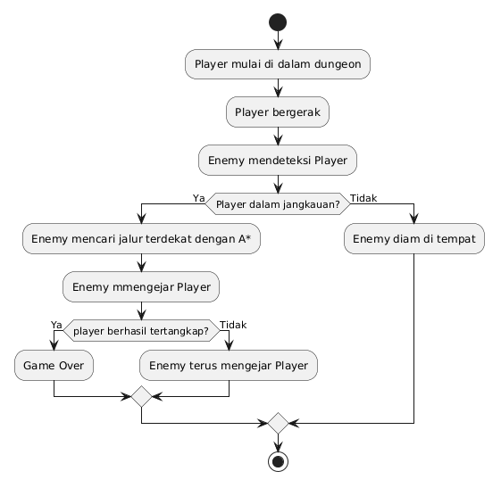

# Tugas 1 - Dungeon enemy AI - A*
## Identifikasi Algoritma
Algoritma yang digunakan adalah algoritma Pathfinding A* (A-Star). Algoritma A* digunakan oleh Enemy untuk mencari jalur yang sesuai dari posisi Enemy menuju posisi Player di dalam dungeon. Sebelum melakukan pencarian jalur, Enemy melakukan deteksi terhadap Player dan mengecek apakah Player berada dalam jangkauan. Jika Player berada dalam jangkauan, algoritma A* digunakan untuk menentukan jalur yang dapat dilalui Enemy menuju Player.

## flowchart

Di sertakan juga kode planuml flowchart nya
[Flowchart PlanUML](flowchart/flowchart.puml)

## Code
Code program menggunakan bahasa pemrograman **Python** dengan library **Pygame**

Source code ada di :
[enemy_ai.py](enemy_ai.py)

### Fitur Program

- Player dapat bergerak di dalam dungeon.
- Player tidak dapat melewati dinding.
- Enemy dapat mendeteksi Player.
- Enemy mengecek jarak dengan Player.
- Enemy menggunakan algoritma A* untuk mencari jalur.
- Enemy bergerak menuju Player.
- Game berakhir ketika Enemy menangkap Player.